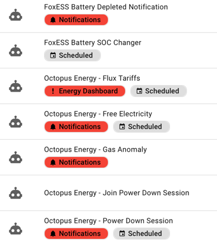
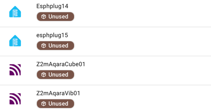
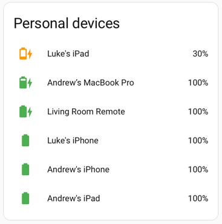
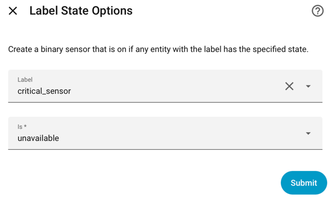
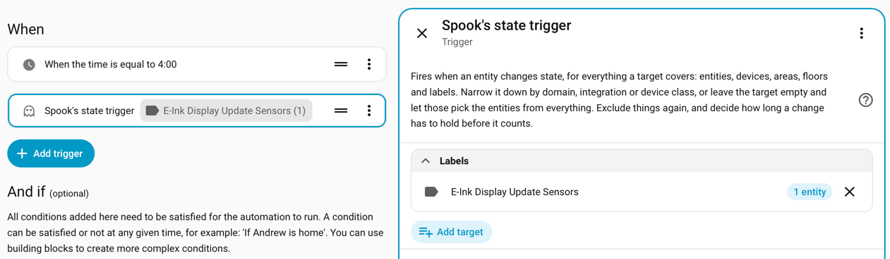

Home Assistant Labels introduced as part of the Organise all the things 2024.4 release were a real game changer 
and I'm still discovering ways to use them so thought I'd share some common techniques I use.

# Visual Organisation

The most obvious use case. I like to flag when an automation is schedule driven or provides a notification so I 
quickly find them when I want to know what did that thing or silence things easily. I also use them as a danger sign
that the labelled automation, device or entity has a lot of impact (energy dashboards) so don't go messing with it on a whim.



I also use them to flag unused devices. I should really remove them but re-pairing can be painful, 
so it's easier to look down the list then go to the box of spare devices when I need one.



# Dashboard Lists

[Auto Entities](https://github.com/thomasloven/lovelace-auto-entities) has a way to filter the list by label, 
so I have a handy list of phones, tablets, laptops on my main dashboard to show their battery state and prompt 
us to charge them. I add a Personal Devices label to the device rather than the entity.

This example is using [Battery Notes](https://🙂github.com/andrew-codechimp/HA-Battery-Notes) of course ;-)




``` yaml
type: custom:auto-entities
card:
  type: entities
  title: Personal devices
filter:
  include:
    - options:
        name:
          type: device
      label: Personal Devices
      integration: battery_notes
      domain: sensor
sort:
  method: state
  numeric: true
```

# Templates

Rather than having to edit a template every time I want to change the sensors in a calculation I use labels, 
then if things change I can just update the label and all templates will reflect the change in entities.

Here's a Template Helper for a problem sensor which returns True (Problem) if any humidity sensor I've labelled 
with Home Humidity is above 60%. That way it's only using the sensors I know are accurate and not in the garden.

``` yaml


{{ (readings | max > 60)
   if entities and readings | count == entities | count
   else none }}
```

# Label State Helper

A shameless plug for one of my custom helper integrations, [Label State](https://github.com/andrew-codechimp/HA-Label-State)
is an easy way to create binary sensors based on state. You can do it all in templates but 
Label State provides a quick UI approach for the basics. It covers both textual sensor state and numeric bounds.
Attributes list the entities so you can easily automate on the sensor change.




``` yaml
alias: Critical Sensors Unavailable
description: ''
triggers:
  - trigger: state
    entity_id:
      - binary_sensor.critical_sensors_unavailable
    to: 'on'
    for:
      hours: 0
      minutes: 5
      seconds: 0
conditions: []
actions:
  - action: notify.persistent_notification
    metadata: {}
    data:
      message: >-
        ‼️ Critical sensors are unavailable {{
        state_attr('binary_sensor.critical_sensors_unavailable', 'entity_names')
        | join(', ') }}  
mode: single
```

# Spook's State Trigger

This is a very new addition to the [Spook](https://github.com/frenck/spook) custom integration.

Spook's [state trigger](https://spook.boo/other-features/#spooks-state-trigger) allows you to add an 
automation trigger when a state of any labelled entity changes (and much much more, but we're talking about 
labels today).

I've started using this for knowing when to refresh e-ink screens. Given the slow refresh I don't want 
them updating every time a state changes, so most things on it change only daily and I have a schedule to refresh it. 
But I do want to know about a few sensors that change infrequently, which when they do I want to see it as soon 
as possible.



I could have done this with Label State or even creating a template helper but triggers
save all that extra leg work. If you want that label state change reflected in multiple places I'd still
go for either of the helpers though.

# Going further

I'm sure once you start thinking about these use cases there are dozens more you could create, 
and I suspect I'll write a follow up 'More ways with labels' in the future.

What I'd like to see is more core dashboard elements and triggers support this, it's getting better 
all the time but there's a lot more that could be done.
